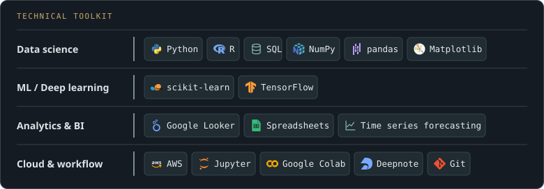

Hey, I'm Vamsi 👋 I'm a Data Science & Statistics student who likes messing around with data, training ML models, and building cool dashboards. Mostly working with Python, SQL, and a bit of applied AI lately. Feel free to look around!

**Areas of interest**

`Data analytics` · `Machine learning` · `Deep learning` · `Applied AI` · `Generative AI`
