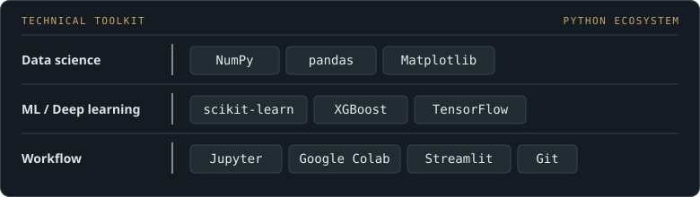

## Data science / Applied AI

Python is my primary language. My focus is understanding data, building models and exploring how machine learning and deep learning can be used in practical AI systems.

**Areas of interest**

`Statistical analysis` · `Machine learning` · `Deep learning` · `Applied AI`

**Currently exploring**

Generative AI, large language models and computer vision — particularly how they can be used to build interactive, intelligent applications.
