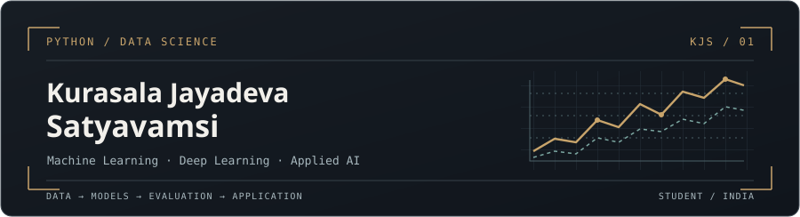

## Focus

Data science student working with Python to explore data, build predictive models and develop practical AI applications. Interested in the full process — from understanding a problem and preparing data to evaluating models and turning them into usable systems.

`Data Science` · `Machine Learning` · `Deep Learning` · `Applied AI`

## Technical stack

**Core**

**Machine learning & neural networks**

**Experimentation & applications**

## Selected experiments & projects

**[Credit Default Risk Intelligence ↗](https://github.com/jayadevuha-ui/credit-default-risk-intelligence)**  
`CLASSIFICATION` · `EXPLAINABLE ML` · `FINANCIAL RISK`

End-to-end credit default prediction with cross-validation, threshold optimization and fairness analysis.

**30,000** client records · **0.7800** test ROC-AUC · [Live demo](https://credit-default-risk-intelligence-69rgyefwwpr9jcnefo2ism.streamlit.app)

---

**[Retail Sales Forecasting Intelligence ↗](https://github.com/jayadevuha-ui/retail-sales-forecasting-intelligence)**  
`TIME SERIES` · `REGRESSION` · `BUSINESS ANALYTICS`

Revenue forecasting with lag features, chronological validation and seasonal baseline benchmarking.

**541,909** raw transactions · **42-day** test horizon · [Live demo](https://retail-sales-forecasting-intelligence-3gt7qsyapxmpho4w7rquft.streamlit.app)

### Academic internship / UNP

Collaborative machine learning projects covering preprocessing, statistical analysis, model comparison and artificial neural networks.

- [Credit Card Approval Prediction](https://github.com/jayadevuha-ui/UNP_ML_CLASSIFICATION_PROJECT_CREDIT_CARD_APPROVAL_USING_PYTHON) — Classification
- [Garment Worker Productivity Prediction](https://github.com/jayadevuha-ui/UNP_ML_REGRESSION_PROJECT_GARMENT_WORKER_PRODUCTIVITY_USING_PYTHON) — Regression

## Exploring next

Generative AI · Large language models · Computer vision · AI-driven interactive applications

---

<a href="mailto:jayadevuha@gmail.com">Contact</a> &nbsp;·&nbsp; <code>jayadevuha-ui</code>

